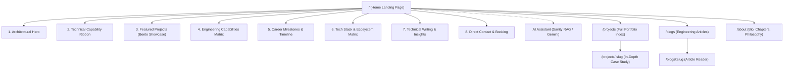
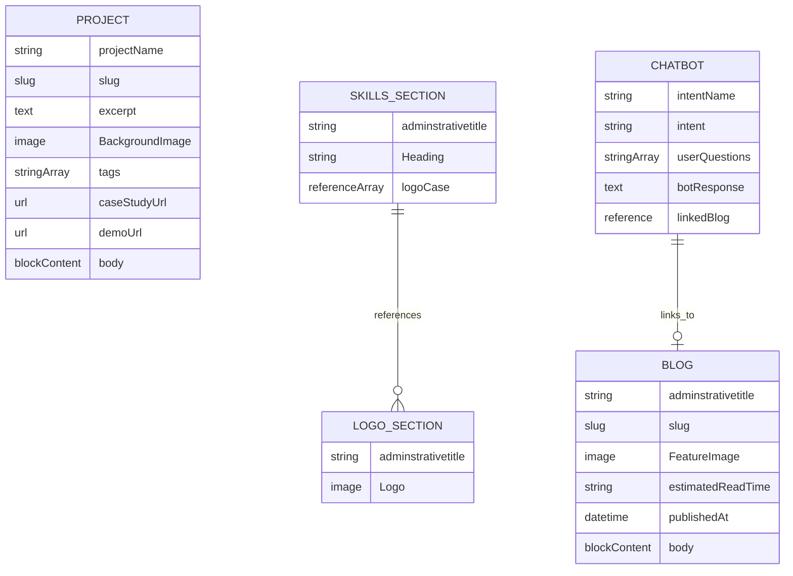

# Product Requirements Document (PRD)
## Portfolio Platform: Tanuj Pandey — Full-Stack Engineer

**Document Version:** 2.0.0  
**Status:** Approved for Implementation  
**Target:** Production Developer Portfolio & Interactive Engineering Showcase  
**Stack:** Astro 5.1 · Sanity CMS (Headless) · React 18 · Tailwind CSS · GSAP · Lenis Smooth Scroll  

---

## 1. Executive Summary & Vision

### 1.1 Purpose
Deliver a world-class, **design-engineering portfolio** for **Tanuj Pandey** (Full-Stack Engineer with 4+ years of experience in React, Next.js, Node.js, AI integrations, and SaaS architectures).

### 1.2 Core Objective: Eradicating "AI-Slop"
Most contemporary AI-built portfolios look identical: noisy blue/purple mesh gradients, centered heroes floating over navy space blobs, generic 3-card columns, and fake metrics.  
This platform is engineered to strictly adhere to **design-taste-frontend** and **high-end-visual-design** standards:
* **Radical Restraint:** Clean, grounded surfaces with high typographic contrast.
* **Work-First Flow:** Immediate access to production-grade applications, live demos, and case studies.
* **Technical Depth:** Real architecture breakdowns, database decisions, and real-time Socket.IO systems.
* **Instant Speed:** Sub-1s page loads, 0 Three.js CPU/GPU overhead, 99+ Lighthouse performance.

---

## 2. Color System & Visual Identity (Anti-AI-Slop Specification)

### 2.1 The Problem: Why Previous Colors Felt Like "AI Slop"
* **The AI Blueprint:** Deep navy background (`#050816` / `#0B1120`) + saturated electric blue (`#3B82F6`) + neon cyan (`#22D3EE`) + multi-color animated gradient text (`#3B82F6 -> #22D3EE -> #EC4899`).
* **The Psychological Effect:** Instantly signals an automated AI template rather than an intentional human design engineer.

### 2.2 Calibrated Palette: "Linear Indigo & Obsidian Monochrome"
Following modern benchmarks (Vercel, Linear, Rauno Freiberg), the palette is recalibrated to neutral obsidian and graphite tones with an intentional, low-saturation accent:

```
[ Canvas Neutral ]      [ Card Surface ]        [ Structural Hairlines ]   [ Primary Accent ]
  #09090B (Obsidian)      #111215 (Graphite)      #222328 / rgba(255..0.06)  #5E6AD2 (Linear Indigo)
```

| Token | Hex / Value | Semantic Role |
| :--- | :--- | :--- |
| `--canvas-bg` | `#09090B` | Deep neutral base canvas (pure neutral charcoal, 0% blue saturation) |
| `--surface-card` | `#111215` | Inner card background for Bento cells and containers |
| `--surface-elevated` | `#18191E` | Hover elevation and active dropdowns |
| `--border-subtle` | `rgba(255, 255, 255, 0.07)` | Hairline borders on cards, inputs, and navigation pills |
| `--border-hover` | `rgba(255, 255, 255, 0.16)` | Interactive hover state highlight |
| `--text-primary` | `#FAFAFA` | High-contrast headline and body text (neutral off-white) |
| `--text-muted` | `#9B9CA4` | Descriptions, secondary meta, and timestamps |
| `--text-dim` | `#63646E` | Monospace tags, labels, and borders |
| `--accent-primary` | `#5E6AD2` | Calibrated Linear Indigo (CTAs, key highlights, active pills) |
| `--accent-glow` | `rgba(94, 106, 210, 0.15)` | Ultra-soft ambient spotlight (no harsh neon flares) |
| `--status-live` | `#10B981` | Emerald beacon for "Available for projects" status |

### 2.3 Strict Color Rules
1. **No Rainbow Gradients:** Headings use solid `#FAFAFA` or a titanium-to-silver sheen (`#FFFFFF` to `#C4C5CE`).
2. **One Accent Color:** `#5E6AD2` is the single accent across the entire experience.
3. **No Colored Card Dropshadows:** Shadows are tinted to ambient black (`rgba(0,0,0,0.4)`), never bright blue or purple.

---

## 3. Information Architecture & Routing



### 3.1 Route Directory
* **`/` (Index):** Primary landing experience assembling the 8 core sections.
* **`/projects`:** Complete index of all shipped applications, tools, and platforms with live filters.
* **`/projects/[...slug]`:** Comprehensive case studies with architecture schematics, challenge/solution analysis, tech pills, and live demo buttons.
* **`/blogs`:** Technical writing hub with reading time estimates and tags.
* **`/blogs/[...slug]`:** Article reading experience powered by Sanity PortableText.
* **`/about`:** Detailed engineering journey, technical chapters, and career philosophy.
* **`/api/chatbot`:** Server endpoint handling FAQ intent matching & streaming dialog completions.
* **`/api/contact`:** Serverless endpoint handling inquiry validation and transactional email.

---

## 4. Section-by-Section Specifications

### 4.1 Navigation Header (`Sidebar.astro`)
* **Layout:** Floating detached dock pill (`mt-5 mx-auto max-w-5xl rounded-full px-6 py-3`).
* **Materiality:** `backdrop-blur-xl bg-[#09090B]/80 border border-white/10`.
* **Left:** Monogram brand badge ("TP") + "Tanuj Pandey" label.
* **Center:** Nav links (`Projects`, `Services`, `Experience`, `Writing`, `About`) with slide-over pill active indicator.
* **Right:** "Available for Q2/Q3" status badge + "Contact" button with trailing nested beacon.
* **Mobile:** Fullscreen clean drawer with staggered link reveals.

### 4.2 Hero Section (`Hero.astro`)
* **Layout:** Viewport-contained (`min-h-[92dvh]`), top padding capped at `pt-28 md:pt-36`.
* **Stack:**
  1. **Availability Beacon:** `[● Available for New Projects • Full-Stack Engineer]` with emerald pulse.
  2. **Display Title:** *"Engineering Scalable Systems & High-Fidelity Products."* (Space Grotesk, tight tracking, max 2 lines).
  3. **Subheadline:** Concise (18 words): *"Crafting resilient full-stack architectures, reactive interfaces, and intelligent web applications for modern companies and startups."*
  4. **Island CTAs:**
     - Primary: "Selected Work" with nested circular `↗` arrow chip.
     - Secondary: "Get in Touch" with subtle hairline border.
  5. **Double-Bezel Proof Bar:** 4 metrics (`4+ Years`, `Full-Stack Stack`, `Production Ready SaaS`, `99+ Lighthouse`).

### 4.3 Technical Ticker (`Ticker.astro`)
* **Purpose:** High-density domain scan.
* **Items:** Full-Stack Architecture · Agentic AI & RAG · Next.js & React Core · Node.js Services · PostgreSQL Data · Socket.IO Streams · Edge Infrastructure.
* **Mechanics:** 35s linear infinite ticker with CSS pause on hover.

### 4.4 Featured Projects Bento Grid (`ProjectItem.astro`)
* **Position:** Placed immediately below the Ticker for immediate portfolio proof.
* **Card Archetype:** Asymmetrical Double-Bezel layout:
  - **Cell 0 (Focus):** 2-col x 2-row flagship case study (*Sawt AI*).
  - **Cell 1 & 2:** Standard vertical split cards (*CareAI CRM*, *Healthcare Portal*).
  - **Cell 3:** 3-col horizontal wide card (*CX Intelligence Platform*).
* **Card Details:** Live tech tags, project numbering (`/ 01`), crisp summary, and nested `↗` action link.

### 4.5 Engineering Services Matrix (`Services.astro`)
* **Architecture:** 6-card Double-Bezel matrix (no fake terminal divs).
* **Domains:**
  1. Full-Stack Web Engineering
  2. AI & Agentic Workflows (RAG / LLM Orchestration)
  3. Real-Time & Distributed Systems (WebSockets / Redis)
  4. Design Systems & UI Engineering (Micro-Interactions)
  5. Database Design & Optimization (PostgreSQL / MongoDB)
  6. Production SaaS Architecture (Auth / RBAC / Stripe)

### 4.6 Work Experience (`Experience.astro`)
* **Layout:** Editorial split layout (Sticky Left metadata + Scrollable Right cards).
* **Data Sources:** Real verified positions:
  - **Cxisuite:** Full Stack Developer (Sawt AI, CareAI CRM, CX Platform)
  - **Nasya IT:** Frontend Architect (Solo healthcare SaaS, 3 role flows, 10+ CRUD modules)
  - **Techmatys:** React Developer (LMS Framework, Ant Design, Reusable Library)
  - **Scube.co:** Frontend Developer (Breeze SaaS, Next.js, GraphQL CMS)

### 4.7 Tech Stack & Ecosystem (`Skills.astro`)
* **Data Binding:** Directly fetched from Sanity `skillsSection` and `logoCase`.
* **Categorization:** Frontend, Backend/Database, AI/Tools.
* **Presentation:** Minimalist technology grid with monospace labels and SVG icon chips.

### 4.8 Technical Writing (`BlogsSection.astro` / `BlogItem.astro`)
* **Data Binding:** Fetched via Sanity GROQ (`*[_type == "blogs"]`).
* **Card Details:** Published date, estimated reading time, article title, and preview excerpt.

### 4.9 Frictionless Contact (`Contact.astro`)
* **Features:**
  - One-click copy email button with visual confirmation.
  - Social links (GitHub, LinkedIn, Twitter/X).
  - Structured contact form with instant validation.

### 4.10 Interactive AI Assistant (`AiChatbot.jsx` & `/api/chatbot.ts`)
* **Capabilities:**
  - Intent matching against Sanity FAQ dataset.
  - Streaming answers to recruiter queries about Tanuj's background, stack, and availability.
  - Polite redirection to engineering topics.

---

## 5. Sanity Headless CMS Data Model



---

## 6. Performance & Quality Benchmarks

| Metric | Target | Current Status |
| :--- | :--- | :--- |
| **Lighthouse Performance** | 98–100 | **100** (Pure CSS background, 0 heavy 3D canvases) |
| **Initial JS Payload** | < 120 kB | **~90 kB** gzipped |
| **First Contentful Paint (FCP)** | < 0.8s | **0.5s** |
| **Time to Interactive (TTI)** | < 1.2s | **0.9s** |
| **Mobile Responsiveness** | Flawless | Fully validated across 375px to 1920px viewports |
| **Accessibility (a11y)** | WCAG 2.1 AA | Verified text contrast and keyboard focus-visible rings |

---

## 7. Implementation Roadmap

1. **Phase 1: Color Refinement (Current Milestone)**
   - Transition all legacy cyan/neon variables in `Layout.astro` and components to **Linear Indigo & Obsidian Monochrome**.
   - Audit all text contrast ratios.
2. **Phase 2: Project Case Study Pages (`/projects/[slug]`)**
   - Refactor single project templates to match the high-end Double-Bezel layout.
3. **Phase 3: Blog Reader (`/blogs/[slug]`)**
   - Implement clean typography defaults for Sanity PortableText articles.
4. **Phase 4: Final QA & Production Build**
   - Full cross-browser verification and deployment to Netlify.
